# Elicitation: Entra login to the gateway, per-user SaaS tokens held by the gateway

Remote MCP servers behind Solo Enterprise for agentgateway. MCP clients
only know the gateway URL. Users sign in with **Microsoft Entra ID**; the gateway runs each SaaS
consent once per user, stores the SaaS token encrypted in Postgres and injects it on every call.

## Verified

All configs below are the ones running on the test cluster (Enterprise agentgateway **v2026.10.1**,
upgraded from 2026.10.0 on 2026-10-24), exported and redacted.

| MCP server | Upstream | Client registration at the SaaS | Verified |
|---|---|---|---|
| [GitHub](./github/) | `api.githubcopilot.com/mcp/` | GitHub OAuth App (client ID + secret) | 2026.10.0, 2026-10-23: `initialize`, `tools/list` 200 |
| [GitHub, no per-user OAuth](./github-no-oauth/) | self-hosted github-mcp-server | GitHub App installation token (ESO), Entra group gate | 2026.10.0, 2026-10-19 |
| [Atlassian Rovo](./atlassian/) | `mcp.atlassian.com/v1/mcp` | Dynamic client registration (none) | 2026.10.0, 2026-10-23 |
| [Datadog](./datadog/) | `mcp.datadoghq.com/v1/mcp` | Dynamic client registration (none) | 2026.10.0, 2026-10-23 |
| [Microsoft 365 (MCP Server for Enterprise)](./o365/) | `mcp.svc.cloud.microsoft/enterprise` | Entra app, delegated `MCP.Application.Read.All` | 2026-10-24: `tools/list`, tool call 200 |
| [Dynatrace](./dynatrace/) | `<env>.apps.dynatrace.com` hosted MCP | Dynatrace OAuth client, PKCE, `resource` workaround | 2026.10.1, 2026-10-26 |
| [Postman](./postman/) | `mcp.postman.com/minimal` | Dynamic client registration (none) | 2026.10.1, 2026-10-26 |
| [Airtable](./airtable/) | `mcp.airtable.com/mcp` | Dynamic client registration (none) | 2026.10.1, 2026-10-26 |
| [ServiceNow](./servicenow/) | `<instance>.service-now.com` (OpenAPI to MCP) | ServiceNow OAuth client (auth code) | 2026.10.1, 2026-10-26 |
| [Cloudflare](./cloudflare/) | `mcp.cloudflare.com/mcp` | Dynamic client registration (none) | 2026.10.1, 2026-10-26 |
| [Salesforce Hosted MCP](./salesforce/) | `api.salesforce.com/platform/mcp/v1/...` | External Client App, public client + PKCE | 2026.10.1, 2026-10-27: `tools/list`, `tools/call` 200 |

Client used for the test: an MCP client configured with only the gateway URL
(`https://<gateway-host>/mcp/<server>`), no client ID.

## Flow



The 16 steps, simplified:

```
MCP client ──(1) POST /mcp/github, no token──────────────▶ gateway  → 401 + resource metadata
MCP client ──(2) discovery: gateway is the authorization server (oauth-issuer)
Browser    ──(3) Entra login (downstream) ──▶ consent screen ──▶ GitHub authorize (upstream, once)
gateway STS ─(4) stores the GitHub token keyed by (Entra sub, backend), encrypted in Postgres
MCP client ──(5) POST /mcp/github + Entra token ─▶ gateway validates JWT, injects GitHub token ─▶ GitHub MCP
```

The MCP client never holds the SaaS token. The MCP server receives a normal request with the
user's own SaaS token in `Authorization`.

## Prerequisites

1. **Entra app registration** for the gateway (single tenant):
   - **Expose an API**: Application ID URI `api://<client-id>`, scope `agentgateway`.
   - **Client secret** (used by the gateway's oauth-issuer).
   - **Web** redirect URI `https://<gateway-host>/oauth-issuer/callback/downstream`.
   - Access token version left at the default (v1), so tokens have
     `iss: https://sts.windows.net/<tenant-id>/` and `aud: api://<client-id>`, which is what the
     backends validate.
2. Enterprise agentgateway with the token-exchange (STS) feature (Helm values below) and a
   license Secret.
3. A TLS certificate for the gateway host.

## Install order

Shared infrastructure ([`00-shared/`](./00-shared/)):

```bash
cd 00-shared
kubectl apply -f 01-postgres.yaml                      # set REPLACE_WITH_POSTGRES_PASSWORD first
kubectl -n agentgateway-system create secret generic agentgateway-token-exchange-config \
  --from-file=config=token-exchange-config.json        # same password in the DB URL
kubectl -n agentgateway-system create secret generic agentgateway-oauth-issuer-config \
  --from-file=KGW_OAUTH_ISSUER_CONFIG=oauth-issuer-config.json
helm upgrade -i enterprise-agentgateway \
  oci://us-docker.pkg.dev/solo-public/enterprise-agentgateway/charts/enterprise-agentgateway \
  -n agentgateway-system --version v2026.10.1 -f agw-values.yaml
kubectl apply -f 02-gateway.yaml -f 03-entra-jwks-and-issuer.yaml
```

Then each MCP server folder (`crs-all.yaml` or the numbered files), and finally `00-shared/04-mcp-cors.yaml` (it references
the MCP routes).

| File | What it does |
|---|---|
| `01-postgres.yaml` | Postgres for the STS. The default SQLite on an emptyDir loses all elicitations and tokens on controller restart |
| `token-exchange-config.json` | STS config: Entra JWKS as subject validator, Postgres URL |
| `oauth-issuer-config.json` | The gateway's OAuth authorization server: Entra as the downstream IdP, consent screen text |
| `agw-values.yaml` | Helm: inject the oauth-issuer config, enable token exchange |
| `02-gateway.yaml` | Gateway + `EnterpriseAgentgatewayParameters` with `STS_URI` (proxy → STS). Without it: `500 token exchange required but not configured` |
| `03-entra-jwks-and-issuer.yaml` | Entra JWKS backend; route `/oauth-issuer` to the controller (port 7777) |
| `04-mcp-cors.yaml` | CORS for browser-based clients (MCP Inspector) |

Per server: one file per CR (numbered in apply order) and the same CRs in `crs-all.yaml`. Typical set:
backend (upstream + inbound Entra JWT validation + resource metadata), token-exchange Secret (upstream OAuth
settings) or typed `entElicitation` policy, the policy that enables elicitation on the backend, and the
HTTPRoute (`/mcp/<server>` plus its two `.well-known` discovery paths). Each folder's README covers the SaaS-side
setup.

**`mcp_resource` in the secret must match the route path** (`/mcp/<server>`) and the `resource` in
the backend's `resourceMetadata`.

## Verify

```bash
H=<gateway-host>
curl -sk https://$H/.well-known/oauth-protected-resource/mcp/github          # 200, resource metadata
curl -sk -o /dev/null -w '%{http_code}\n' -X POST https://$H/mcp/github \
  -H 'content-type: application/json' -H 'accept: application/json, text/event-stream' -d '{}'   # 401
curl -sk https://$H/oauth-issuer/.well-known/oauth-authorization-server     # oauth-issuer metadata

# after a user connects: elicitations per (user, backend)
kubectl -n agentgateway-system exec deploy/token-exchange-postgres -- \
  psql -U agw -d tokenexchange -c "SELECT user_id_claim, resource, status, updated_at FROM elicitations;"
```

Then connect an MCP client to `https://<gateway-host>/mcp/<server>`: Entra login, consent,
SaaS authorize on first use, then `tools/list`.

## Notes

- Only one downstream IdP per oauth-issuer config.
- Elicitations are keyed by the identity claim (default `sub`, configurable with the controller env
  `AGW_ELICITATION_USER_ID_CLAIM`) plus the backend.
- The stored SaaS token is not checked against the Entra identity: whichever SaaS account the user
  approves at consent is the one used.
- Two policy styles are used: Secret-based `tokenExchange.elicitation.secretName`, and typed
  `entElicitation.brokered.chainedAuth` + `entTokenExchange.solo.elicitation` (Dynatrace, ServiceNow).
